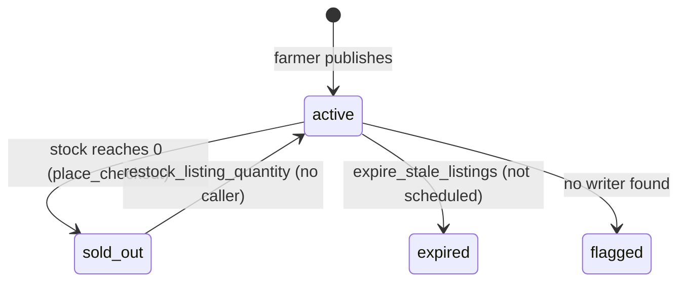

# Listing Lifecycle

**Owner:** Author B (Marketplace)
**Reviewers:** Author A (sync), Author C (checkout stock)
**Last verified against:** migrations up to `20260927093935_recurring_orders_rpc.sql`

## 1. Purpose

How crops, farmer menu entries and produce listings are created, priced, displayed, sold down and retired.

## 2. Key concepts

| Concept | Table | Meaning |
|---|---|---|
| Crop catalogue | `crop` | Shared reference data (name, category, `fallback_image_url`); read-only for clients |
| Farmer menu | `farmer_crop` | A farmer's standing entry per crop: description, `default_price_per_kg`, photo. Composite PK `(farmer_profile_id, crop_id)` |
| Listing (inventory) | `produce_listing` | A batch currently for sale |
| Harvest | `harvest` | **Dropped** in `20260829153627`; `harvested_on` moved onto the listing |

## 3. Data model (final `produce_listing`)

`id`, `farmer_profile_id`, `crop_id`, `price_per_kg` (>= 0), `available_quantity_kg` (>= 0), `status` (`listing_status`: `active`, `sold_out`, `expired`, `flagged`), `status_text` (mirror), `published_at`, `expires_at`, `description`, `image_url`, `harvested_on`, `created_at`, `updated_at` (trigger). Indexes: farmer, crop, status, `idx_listing_active_published` (partial, `status='active'`).

Fallback chains (both client and RPCs):
- Description: `listing.description`, else `farmer_crop.description`.
- Image: `listing.image_url` (crop-photos), `farmer_crop.image_url` (crop-photos), `crop.fallback_image_url` (public `crop-fallback-images`).

`farmer_crop` is synced with a synthetic id `"<farmerProfileId>:<cropId>"`; see [../A-core/data-access.md](../A-core/data-access.md) §6.

## 4. Status state machine

| Transition | Mechanism | Status |
|---|---|---|
| create as `active` | client insert (`status_text = 'active'`); upload -> `status` default `active`; trigger recomputes `status_text` | live |
| `active -> sold_out` | inline `UPDATE` inside `place_checkout` when `available - qty <= 0` | live |
| `sold_out -> active` | `restock_listing_quantity` (service_role) | no caller in dump (cancel does not restock) |
| `active -> expired` | `expire_stale_listings()` (service_role) | not scheduled (only market analytics has a `pg_cron` job); client never sets `expires_at` |
| `flagged` | none | reserved |
| delete | owner `DELETE` policy; BEFORE DELETE trigger notifies buyers with the item in their cart | live |

`decrement_listing_quantity` (race-safe decrement) exists but `place_checkout` does its own locked update instead.

## 5. Publish flow

1. Farmer picks a crop from their menu; price pre-fills from `farmer_crop.default_price_per_kg`; client-side bounds apply (see [pricing-rules.md](pricing-rules.md)).
2. Photo (optional) is enqueued via `CropPhotoService.uploadListingPhoto` (path keyed by listing id).
3. `ProduceListingService.createListing` inserts locally (id chosen by the caller), including `published_at = DateTime.now().toIso8601String()` and `harvested_on` as `yyyy-MM-dd`.
4. PowerSync uploads a `put` (upsert). RLS: `listing_insert_own`, `listing_update_own`.

## 6. Reads

- Farmer's own list: local SQL joining `produce_listing`, `crop`, `farmer_crop` (`watchOwnListings`), newest first.
- Buyers: RPC only, see [search-rpcs.md](search-rpcs.md).
- Farmer public profile: `get_farmer_public_profile` (sums stock of `active` listings per crop). Per-crop batch breakdown: `get_farmer_crop_listings` (model comment: `initial_quantity_kg = available + sold order_item quantity`).

> ⚠ Unverified: `get_farmer_crop_listings(p_farmer_id, p_crop_id)` is called by `FarmerPublicProfileService` but no migration in the dump defines it. Locate or add the migration.

## 7. RLS

`crop`: select all. `farmer_crop`: select/insert/update/delete own. `produce_listing`: select **all**, insert/update/delete own (no column restrictions: an owner may edit price, quantity and status).

## 8. Offline vs online

Publishing works offline (local write, later upload). The sync stream `marketplace_listings` syncs every **active** listing to every device; rows that leave `active` disappear locally (see [../A-core/powersync-sync-and-mirrors.md](../A-core/powersync-sync-and-mirrors.md) §7 item 4), so a farmer's local `watchOwnListings` shows only active listings.

## 9. Edge cases

| Case | Detail |
|---|---|
| Deleting a listing that has orders | `order_item.produce_listing_id` has no cascade; delete presumably fails with an FK error. |
| Listing deleted while in carts | `cart_item` cascades; each buyer gets `listing_removed_from_cart`. |
| Timestamp format | Client `published_at` is a local-time ISO string without offset; the server interprets it in its own zone. |
| Price edits | Carts show live price; checkout uses the price at checkout and snapshots it in `order_item.price_per_kg`. |
| `expires_at` | Checked by `place_checkout`, never set by the client. |

> ⚠ Unverified: FK behaviour on deleting a listing referenced by `order_item`; whether `published_at` timezone skew affects ordering.

## 10. How to modify safely

- New status value: `alter type listing_status add value`, update mirror consumers (`status_text` filters in the stream and `CartLineItem`), `place_checkout` checks and `search_*` filters.
- To schedule expiry: add a `cron.schedule(... expire_stale_listings())` migration and have the client set `expires_at`.
- To wire restock, call `restock_listing_quantity` from an order-cancel path (see [../C-orders-payments/order-state-machine.md](../C-orders-payments/order-state-machine.md)).

## Source files

`lib/features/listings/produce_listing_service.dart`; `lib/models/produce_listing.dart`, `farmer_profile.dart`, `farmer_public_profile.dart`; `lib/features/profile/farmer/farmer_profile_service.dart`; `lib/core/storage/crop_photo_service.dart`; sync-config YAML. Migrations: `20260818012120_farmer_profile`, `20260827085839_crop_image_fallback_and_farmer_photo`, `20260827092647_harvest_and_listing`, `20260827092825_listing_lifecycle_functions`, `20260827094812_cross_component_foreign_keys`, `20260827094859_powersync_compat_view`, `20260829153627_crop_produce_listing_rework`, `20260906163834_farmer_crop_update_policy`, `20260904170222`/`20260916050308` (checkout stock update), `20260916155547_get_farmer_public_profile`.