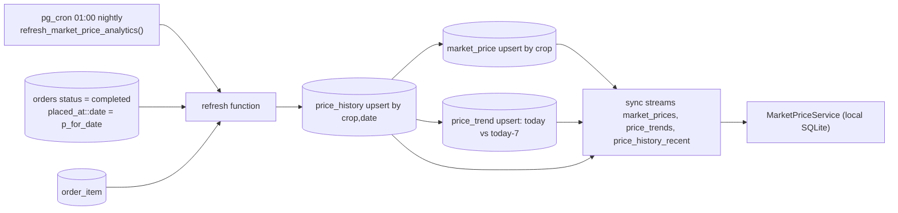

# Market Analytics

**Owner:** Author B (Marketplace)
**Reviewers:** Author C (order status feeds it), Author A (sync)
**Last verified against:** migrations up to `20260927093935_recurring_orders_rpc.sql`

## 1. Purpose

Server-side aggregation of achieved prices into `price_history`, `market_price` and `price_trend`, synced read-only to devices.

## 2. Data model

| Table | Key | Columns |
|---|---|---|
| `price_history` | `id`; unique `(crop_id, price_date)` | `avg/min/max_price_per_kg`, `order_count`, `created_at` |
| `market_price` | PK `crop_id` | `avg/min/max_price_per_kg`, `as_of_date`, `updated_at` |
| `price_trend` | PK `crop_id` | `trend_direction` (`up`/`down`/`stable`), `change_percent`, `period_days` (default 7), `computed_at` |

RLS: select for everyone; no client write policies.

## 3. Pipeline

`refresh_market_price_analytics(p_for_date date default current_date)` (`20260827094740`, not security definer, `execute` only for `service_role`):
1. `price_history`: per crop, `avg/min/max(order_item.price_per_kg)` and `count(*)` over order items of orders with `status = 'completed'` and `placed_at::date = p_for_date`; upsert on `(crop_id, price_date)`.
2. `market_price`: copies that day's history row per crop (`as_of_date = price_date`).
3. `price_trend`: joins today's history to the row exactly 7 days earlier; direction by comparing averages; `change_percent = round((curr-prev)/nullif(prev,0)*100, 2)`; `period_days = 7`.

Schedule: `20260915165125_schedule_market_price_refresh` enables `pg_cron` and schedules `refresh_market_price_analytics_nightly` at `0 1 * * *`.

## 4. Client

Streams: `market_prices` (`crop_id as id`), `price_trends` (`crop_id as id`), `price_history_recent` (`SELECT *`, full table). `MarketPriceService` offers `getForCrop`/`watchForCrop`, trend equivalents, batch `watchForCrops` / `watchTrendsForCrops` (one `IN (...)` query, empty input returns an empty map), and `getRecentHistory(cropId, limit = 30)`. Models: `MarketPrice`, `PriceTrend` (`PriceTrendDirection`), `PriceHistory`. Everything works offline from the mirror.

## 5. Issues found

> ⚠ Unverified: **nothing in the dump moves an order to `completed`.** Delivery sync ends at `delivered` (`transition_delivery_status`), and no function or job applies `delivered -> completed`. Since the aggregation reads only `completed` orders, analytics tables may stay empty.

> ⚠ Unverified: the cron job runs at 01:00 with the default `current_date`, i.e. it aggregates the day that has just started, which has almost no orders. Nothing backfills the previous day. Also confirm `pg_cron` timezone (normally UTC; Sri Lanka is UTC+5:30).

> ⚠ Unverified: trend rows require a `price_history` row exactly 7 days earlier for the same crop; crops with gaps get no trend.

Other notes: averages are per order item (not quantity-weighted); `order_count` counts items, not orders; `market_price` only updates crops that have history for the processed date.

## 6. Relationship to `crop_price_bounds`

`crop_price_bounds.dart` is static, client-only guidance; this pipeline is observed data. See [pricing-rules.md](pricing-rules.md).

