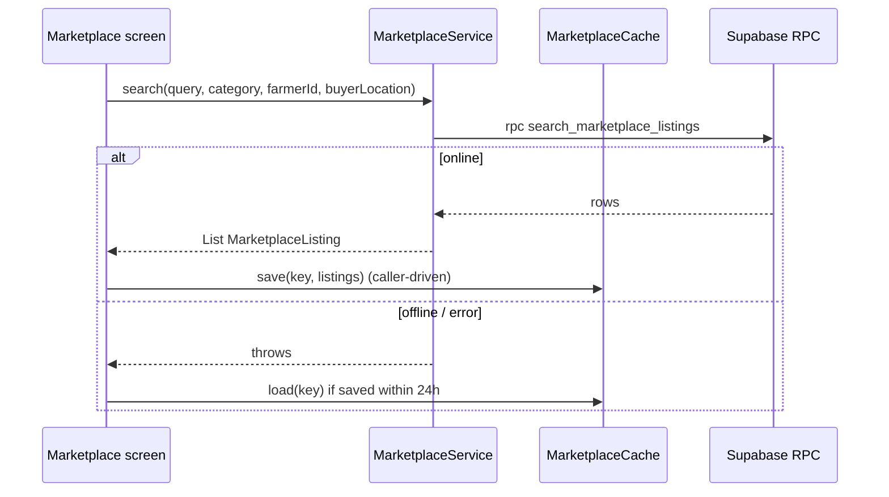

# Marketplace Search RPCs

**Owner:** Author B (Marketplace)
**Reviewers:** Author A (RLS/architecture), Author C (buyer distance used in fees)
**Last verified against:** migrations up to `20260927093935_recurring_orders_rpc.sql`

## 1. Purpose

Buyers cannot read `profile` or `farmer_crop` under RLS, and SQLite has no PostGIS or pg_trgm, so the marketplace is **server-queried**. Three `SECURITY DEFINER` RPCs return marketplace-safe columns (no phone, no address).

## 2. RPC signatures (all `security definer`, `search_path = public, extensions, pg_temp`, `execute` granted to `authenticated` only)

| RPC | Parameters | Returns | Final migration |
|---|---|---|---|
| `search_marketplace_listings` | `p_query text = null`, `p_category crop_category = null`, `p_farmer_id uuid = null`, `p_buyer_lat`, `p_buyer_lng double precision = null`, `p_limit int = 20`, `p_offset int = 0` | table of listings | `20260906163916_fix_marketplace_image_fallback` |
| `get_marketplace_listing` | `p_listing_id uuid`, `p_buyer_lat`, `p_buyer_lng` | 0 or 1 row, same shape | `20260906163916_fix_marketplace_image_fallback` |
| `list_marketplace_farmers` | `p_buyer_lat`, `p_buyer_lng`, `p_limit int = 10` | table of farmers | `20260829211154_marketplace_buyer_access` |

Listing columns: `id`, `farmer_profile_id`, `farmer_name`, `farmer_avatar_url`, `farmer_location_text`, `crop_id`, `crop_name`, `crop_category` (text), `listing_image_url`, `farmer_crop_image_url`, `crop_fallback_image_url`, `description`, `price_per_kg`, `available_quantity_kg`, `harvested_on`, `published_at`, `distance_km`.

Farmer columns: `farmer_profile_id`, `farmer_name`, `farmer_avatar_url`, `farmer_location_text`, `crop_names text[]`, `listing_count bigint`, `distance_km`.

The image tiers are returned separately because they live in different buckets (fix in `20260906163916`). `distance_km` is computed with `ST_Distance(...) / 1000` rather than returning the geography, because PostgREST serialises geography as WKB hex.

## 3. Search behaviour

`search_marketplace_listings`:
- Filter: `status = 'active'` and `available_quantity_kg > 0`; optional category and farmer.
- Text match (any): `crop.name % q` (trigram), `crop.name ilike %q%`, farmer full name `ilike`, `profile.location_text ilike`. Null/blank query matches all.
- Trigram threshold: the final function runs `select set_limit(0.25);` as its first statement (the earlier `set pg_trgm.similarity_threshold` function option failed with `42501` for the migration role).
- Order: `similarity(crop.name, q) desc nulls last`, then distance ascending (nulls last), then `published_at desc`, then `id`. The distance expression is repeated because SQL functions cannot order by output aliases.
- Paging: `limit greatest(p_limit,0) offset greatest(p_offset,0)`.

`get_marketplace_listing` does **not** filter on status or stock, deliberately, so an open detail screen does not blank when stock sells out.

`list_marketplace_farmers`: farmers with at least one active, in-stock listing; `array_agg(distinct crop name order by name)`, `count(distinct listing)`; ordered by distance (nulls last) then listing count descending.

Indexes: `idx_crop_name_trgm`, `idx_profile_name_trgm`, `idx_profile_location_text_trgm`, `idx_listing_active_published` (partial), `idx_listing_status`.

## 4. Client

`MarketplaceService.search` trims the query (blank -> null) and maps to the RPC parameters. `MarketplaceCache` stores JSON in `SharedPreferences` under `marketplace_cache_v1_<query>|<category>|<farmerId>` with a 24 h max age. It is a browse-only fallback, not offline-first. Who calls `save`/`load` is UI code, not in the dump.

Model notes: `MarketplaceListing.isSoldOut`, `displayImage` (three tiers to bucket); numeric columns can arrive as `num` or `String` (`_toDouble`).

## 5. Permissions

RLS is bypassed inside these functions by design; safety comes from the fixed column lists. Any authenticated user can call them. Storage reads for images come from the `*_select_authenticated` policies ([../A-core/media-pipeline.md](../A-core/media-pipeline.md)).

Unused legacy objects: view `marketplace_listing_read` (final `20260829153627`, security invoker, returns zero rows for buyers) and `search_produce_listings` (`returns setof marketplace_listing_read`, never granted).

## 6. Offline vs online

Online only; cache fallback up to 24 h for a previously used key.

## 7. Edge cases

| Case | Detail |
|---|---|
| Buyer without location | `distance_km` null; ordering falls back to newest |
| Farmer without location | `distance_km` null for that row |
| `%` / `_` in the query | Not escaped in `ilike` patterns, so they act as wildcards |
| Farmer-name / location-only matches | Still returned; ranked after crops with high name similarity |
| Deep pagination | `offset` based; results can shift as listings sell out |
| `set_limit` | Session-level setting; confirm it behaves as intended inside a `stable` function and under connection pooling |

> ⚠ Unverified: behaviour of `set_limit(0.25)` inside a `stable` SQL function under pooling, and whether the `%` operator uses that value in practice.

## 8. How to modify safely

- Changing the return shape needs `drop function` then `create function` (you cannot `create or replace` with a different return type) and a matching `MarketplaceListing.fromMap` change; re-issue `revoke ... from public; grant ... to authenticated`.
- Keep the column list explicit; never return phone or address.
- Add indexes for any new filter and mirror the distance expression in `order by`.

## Source files

`lib/features/marketplace/marketplace_service.dart`, `marketplace_cache.dart`; `lib/models/marketplace_listing.dart`. Migrations: `20260827092745_search_and_discovery`, `20260829153627_crop_produce_listing_rework`, `20260829211154_marketplace_buyer_access`, `20260906163916_fix_marketplace_image_fallback`.