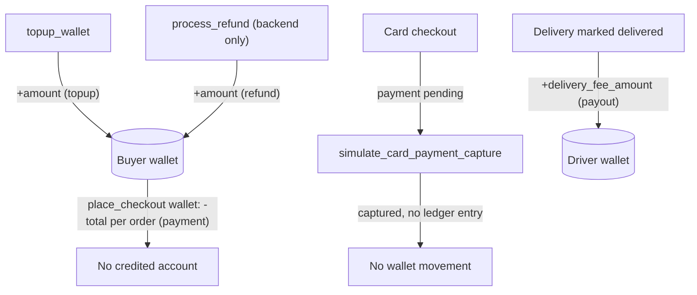

# Money Flow: Wallet, Payments, Refunds, Payouts

**Owner:** Author C (Cart, orders, wallet, payments)
**Reviewers:** Author D (driver payout), Author B (fees)
**Last verified against:** migrations up to `20260927093935_recurring_orders_rpc.sql`

## 1. Purpose

Who pays whom, when, and through which function. Currency is LKR. There is no payment gateway; wallet and card flows are internal or simulated.

## 2. Data model

| Table | Key columns |
|---|---|
| `wallet` | `profile_id` (unique), `balance numeric >= 0`, `currency` default `LKR`; created lazily |
| `wallet_transaction` | `wallet_id`, `type` (`wallet_txn_type`: `topup`, `payment`, `payout`, `refund`, `withdrawal`, `adjustment`), `amount` (signed, `<> 0`), `balance_after`, `reference_table`, `reference_id` |
| `payment` | `order_id` (unique), `buyer_profile_id`, `method` (`card`/`wallet`), `amount`, `status` (`pending`, `authorized`, `captured`, `failed`, `refunded`), `gateway_reference` |
| `payment_transaction`, `refund_request`, `refund` | attempt log (unused), buyer request, processed refund (`automatic`/`manual`) |

## 3. Functions

| Function | Caller | Behaviour | Final migration |
|---|---|---|---|
| `apply_wallet_transaction(profile, type, signed amount, ref table, ref id)` | service role / definer functions only | Locks wallet (`for update`), creates if missing, rejects if balance would go negative (`P0001`), updates balance, inserts ledger row. **The only place `wallet.balance` changes.** | `20260827094613_wallet` |
| `topup_wallet(p_amount)` | any authenticated user | requires amount > 0 and <= 1,000,000; credits own wallet (`topup`). No gateway. | `20260916050421_wallet_topup_rpc` |
| `place_checkout` | buyer | wallet method: debits `total` per farmer order and marks payment `captured` | `20260916050308` |
| `simulate_card_payment_capture(p_order_id)` | order's buyer | demo webhook: card payment `pending -> captured`, `gateway_reference = 'DEMO-...'`; no ledger effect | `20260916050308` |
| `transition_delivery_status` | assigned driver | on `delivered`, credits the driver `delivery_fee_amount` (`payout`) if > 0 | `20260916050308` |
| `evaluate_refund_eligibility(order)` | buyer/farmer | read-only rules (below) | `20260827094657` |
| `process_refund(order, request, amount)` | service role | credits buyer wallet (`refund`), payment `refunded`, refund row, closes request | `20260827094657` |

## 4. Flow

## 5. Who receives what (final behaviour)

| Party | Paid? |
|---|---|
| Buyer | Debited `subtotal + delivery_fee + tax` per farmer order (wallet method only) |
| Driver | Credited the order's `delivery_fee_amount` when the delivery is `delivered` |
| Farmer | **No credit found** for the produce subtotal |
| Platform | **No credit found**; tax and subtotal debits have no counter-entry |

> ⚠ Unverified: no function in the dump pays farmers or records platform revenue/tax. The debit of the buyer's wallet is not matched by any credit except the driver fee. Confirm the intended settlement model (this affects the Lab 10 monetisation inputs).

> ⚠ Unverified: for `card`, the payment stays `pending` until `simulate_card_payment_capture`; capture never debits or credits any wallet, and nothing pays the farmer or driver from card money except the driver payout (which credits the driver regardless of payment method).

## 6. Refund rules (`evaluate_refund_eligibility`)

| Order status | Result |
|---|---|
| `placed`, `confirmed`, `assigned` | eligible: `automatic_full_refund_pre_pickup` |
| `picked_up`, `in_transit` | not eligible: `not_eligible_after_pickup` |
| `delivered`, `completed` | eligible within 48 h of the `delivered` history row: `within_dispute_window_manual_review`; else `past_dispute_window` |
| anything else (incl. `packed`, `cancelled`) | `not_eligible` |

`process_refund` has an idempotency guard (`payment.status = 'refunded'` raises). It refunds to the wallet regardless of original method. Nothing calls it (not `cancel_order`), and there is no client entry point besides a `refund_request` insert policy.

## 7. Notifications

`trg_notify_payment_status`: `payment_received` when `captured`, `payment_failed` when `failed` (update triggers only; the wallet path fires on the in-transaction update). `trg_notify_refund`: `refund_processed` on refund insert. See [../D-delivery-chat-notifications/notification-events.md](../D-delivery-chat-notifications/notification-events.md).

## 8. Client

`WalletService`: `watchBalance(profileId)` (null = no wallet yet, treat as 0), `watchTransactions(profileId, limit = 50)` (joined through `wallet`), `topUp(amount)` -> RPC. `WalletTransactionType` parsing uses `firstWhere` and throws on unknown types. Transaction labels use `transaction_type_*` keys in `common.json`.

## 9. RLS

Wallet tables: select own only; no client writes. `payment`: select as buyer. Sync: `own_wallet`, `own_wallet_transactions`, `own_payments`, `own_refunds`, `own_refund_requests`.

## 10. Offline vs online

Balances/transactions are readable offline; top-up and checkout need a connection. Balance may lag until sync.

## 11. Edge cases

- Insufficient balance during a multi-farmer checkout rolls back all orders and stock changes.
- First transaction creates the wallet; two concurrent first transactions could race on the unique `profile_id` (second raises).
- Driver payout runs once (repeat `delivered` calls fail the order transition).
- Recurring orders would debit the wallet directly, but that function is broken (see [recurring-orders.md](recurring-orders.md)).
- Wallet enum values `withdrawal`, `adjustment` are defined but unused.

## 12. How to modify safely

1. Change balances only through `apply_wallet_transaction`.
2. To pay farmers: add credits inside `transition_delivery_status` (on `delivered`) or a settlement function, using `type = 'payout'` and references to `orders`.
3. Wire `cancel_order` to `process_refund` and `restock_listing_quantity` in one transaction if refunds are required.
4. Never grant `apply_wallet_transaction` or `process_refund` to `authenticated`.
5. Replace `topup_wallet` with a gateway-confirmed path before production.

## Source files

`lib/features/wallet/wallet_service.dart`; `lib/models/wallet.dart`; `assets/translations/en/common.json`; sync-config YAML. Migrations: `20260827094613_wallet`, `20260827094657_payment_and_refund`, `20260829050340_notification_events`, `20260916050308_wallet_payment_and_payout`, `20260916050421_wallet_topup_rpc`, `20260927093935_recurring_orders_rpc`.