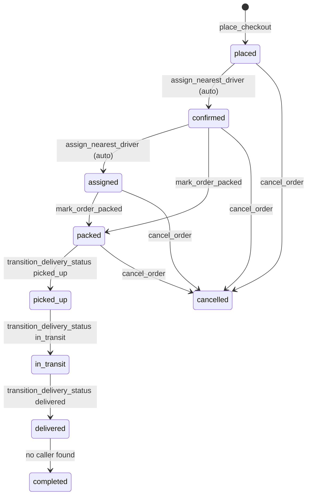

# Order and Delivery State Machines

**Owner:** Author C (Cart, orders, wallet, payments)
**Reviewers:** Author D (delivery), Author B (analytics/reviews depend on statuses)
**Last verified against:** migrations up to `20260927093935_recurring_orders_rpc.sql`

## 1. Purpose

Defines the final order and delivery status enums, the allowed transitions, and which RPC moves which one. Each order is **per farmer**; siblings share `checkout_group_id`.

## 2. Enums

`order_status` (created `20260827093223_orders`; `packed` added after `assigned` by `20260915000000_mark_order_packed`): `placed`, `confirmed`, `assigned`, `packed`, `picked_up`, `in_transit`, `delivered`, `completed`, `cancelled`.

`delivery_status` (`20260827094000`): `unassigned`, `assigned`, `picked_up`, `in_transit`, `delivered`. There is **no** `packed` or `cancelled` delivery status.

Dart mirrors: `OrderStatus`, `DeliveryStatus` in `order_detail_models.dart`. `OrderStatus.fromDb` defaults unknown values to `placed`.

## 3. Final transition rules

`transition_order_status(order_id, new_status, changed_by, note)` was last redefined in **`20260915000000_mark_order_packed.sql`**:

| From | Allowed to |
|---|---|
| `placed` | `confirmed`, `cancelled` |
| `confirmed` | `assigned`, `packed`, `cancelled` |
| `assigned` | `packed`, `cancelled` |
| `packed` | `picked_up`, `cancelled` |
| `picked_up` | `in_transit` |
| `in_transit` | `delivered` |
| `delivered` | `completed` |
| `completed`, `cancelled` | none |

Behaviour: row lock (`select ... for update`), invalid transition raises `P0001`, updates `orders.status`/`updated_at`, inserts an `order_status_history` row (`changed_by`, `note`). It is `security definer`, executable only by `service_role` (nested calls from other definer functions work regardless).

> ⚠ Unverified: the final version **does not send notifications**. The `20260829050340_notification_events` version added `send_notification` calls (`order_status_changed` to buyer and farmer), but `20260915000000` replaced the function without them. Confirm whether that regression is intended.

> ⚠ Unverified: from `assigned`, only `packed`/`cancelled` are allowed. `transition_delivery_status(..., 'picked_up')` maps to order `picked_up`, which raises unless the order is `packed`. Driver "Picked Up" before the farmer marks packed therefore fails (and the whole RPC rolls back, including the delivery row update).

> ⚠ Unverified: no code moves `delivered -> completed`. This affects market analytics ([../B-marketplace/market-analytics.md](../B-marketplace/market-analytics.md)) and the client label mapping (`delivered` already shows "Completed").

## 4. Who moves what

| Action | Caller | RPC / function | Order effect | Delivery effect |
|---|---|---|---|---|
| Checkout | buyer | `place_checkout` | inserts `placed` | none |
| Auto-dispatch | system | `assign_nearest_driver` | `placed -> confirmed -> assigned` (notes `auto: ...`) | inserts `delivery` (`assigned`) + `delivery_assignment` |
| Mark packed | farmer of the order | `mark_order_packed(p_order_id, p_note)` | `confirmed`/`assigned -> packed` | none |
| Pick up | assigned driver | `transition_delivery_status(id, 'picked_up')` | `packed -> picked_up` | `status`, `picked_up_at` |
| Start transit | assigned driver | `... 'in_transit'` | `picked_up -> in_transit` | `status` |
| Deliver | assigned driver | `... 'delivered'` | `in_transit -> delivered` | `status`, `delivered_at`; **driver payout** |
| Cancel | buyer or farmer | `cancel_order(p_order_id, p_note)` | `-> cancelled` | none |

`DriverHomeService.confirmPickup` calls `transition_delivery_status` twice, `picked_up` then `in_transit`. The two calls are separate transactions: if the second fails, the delivery stays `picked_up`. `OrderService` also exposes `confirmPickup`, `markInTransit`, `markDelivered`, `markOrderPacked`, `cancelOrder`.

`transition_delivery_status` (final `20260916050308`): a non-null caller must be the current assignee (`42501` otherwise; service role passes). It updates the delivery first, maps status (`assigned`->`assigned`, `picked_up`, `in_transit`, `delivered`; `unassigned` maps to null so **no order sync**), then calls `transition_order_status`. It does not validate delivery-status ordering by itself; the order state machine is the gate.

Mapping table:

| Delivery status | Order status |
|---|---|
| `unassigned` | none (no sync) |
| `assigned` | `assigned` |
| `picked_up` | `picked_up` |
| `in_transit` | `in_transit` |
| `delivered` | `delivered` |

`packed` and `cancelled` exist only on the order side.

## 5. Permissions

| Function | Authorization |
|---|---|
| `cancel_order` | `auth.uid()` must equal buyer or farmer (`42501`); granted to `authenticated` |
| `mark_order_packed` | must equal farmer (`42501`); source status must be `confirmed` or `assigned` (`P0001`) |
| `transition_delivery_status` | current assigned driver, or service role |
| `transition_order_status` | service role / nested definer calls only |

Order RLS: select for buyer/farmer (`orders_select_buyer_or_farmer`) and the assigned driver (`orders_select_assigned_driver`, via helper `is_assigned_driver_for_order`); no insert/update/delete for clients.

## 6. Client filters (`order_providers.dart`)

| Provider | Statuses |
|---|---|
| Buyer active | placed, confirmed, assigned, packed, picked_up, in_transit |
| Buyer history / farmer history / driver completed | delivered, completed, cancelled |
| Farmer "to pack" | placed, confirmed, assigned |
| Farmer "in transit" | packed, picked_up, in_transit |
| Driver pickup requests | delivery status `assigned`, `packed` (note: delivery has no `packed`) |
| Driver active | `picked_up`, `in_transit` |

Model helpers: `isCancellable` (placed..packed), `isReviewable` (`delivered` only, mirroring `submit_farmer_review`), `stepperIndex` (0 placed/confirmed/assigned, 1 packed, 2 picked_up/in_transit, 3 delivered/completed, -1 cancelled).

