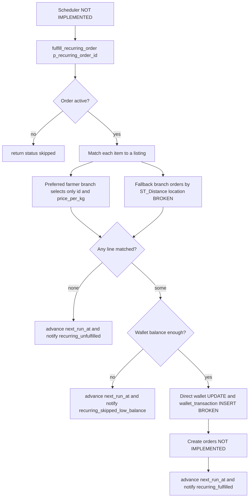

# Recurring Orders (INCOMPLETE)

**Owner:** Author C (Cart, checkout, orders, wallet, payments, reviews)
**Reviewers:** Author B (listings/matching), Author D (notifications)
**Last verified against:** migrations up to `20260927093935_recurring_orders_rpc.sql`

> **Status: schema and a draft RPC exist. This is NOT a working feature.** Nothing schedules it, nothing in the Dart code in the dump calls it, the sync streams reference dropped columns, and `fulfill_recurring_order` cannot run to completion. Do not present it as delivered anywhere (poster, pitch, README).

## 1. Purpose

Intended design (from migration comments): a buyer defines a named recurring schedule containing one or more recurring templates (frequency + items). A scheduled job would match each item to an active listing, charge the wallet, create real `orders`, and advance the next run date.

## 2. Key concepts

| Concept | Meaning |
|---|---|
| `recurring_schedule` | Buyer-owned named group ("label") with a status. |
| `recurring_order` | A template under a schedule: frequency, `day_of_week`, `next_run_at`, delivery address/location. |
| `recurring_order_item` | Crop + quantity, optional `preferred_farmer_id`. |
| `orders.source` | `'manual'` (default) or `'recurring'`. `place_checkout` never sets it. |
| Matching (as drafted) | Preferred farmer's active listing, else cheapest active listing of the crop. |

## 3. Data model (final)

### Enums

| Enum | Values | Defined |
|---|---|---|
| `recurring_frequency` | `weekly`, `biweekly`, `monthly` | `20260827093414_recurring_orders` |
| `recurring_order_status` | `active`, `paused`, `cancelled` | same (reused by `recurring_schedule.status`) |

### Tables

| Table | Columns (final) | Notes |
|---|---|---|
| `recurring_schedule` | `id`, `buyer_profile_id` (FK `buyer_profile`, cascade), `label` NOT NULL, `status` (`recurring_order_status`, default `active`), `created_at` | `20260927093817_update_recurring_orders`. Index on buyer. |
| `recurring_order` | `id`, `schedule_id` NOT NULL (FK `recurring_schedule`, cascade), `frequency`, `day_of_week smallint` (0–6, 0 = Sunday), `next_run_at`, `delivery_address jsonb`, `delivery_location geography`, `status`, `created_at`, `updated_at`, plus mirror columns `frequency_text`, `status_text`, `delivery_location_geojson` | `buyer_profile_id` and `farmer_profile_id` were **dropped** (with CASCADE) and existing rows deleted by `20260927093817`. |
| `recurring_order_item` | `id`, `recurring_order_id` (cascade), `crop_id`, `quantity_kg > 0`, `preferred_farmer_id` (FK `farmer_profile`, nullable), `created_at` | |
| `orders.source` | `text not null default 'manual' check (source in ('manual','recurring'))` | Not in the local `orders` mirror schema and not streamed. |

## 4. Flow (intended, with break points)

## 5. RPCs and triggers

| Object | Definition | State |
|---|---|---|
| `generate_orders_from_recurring_templates() returns int` | `20260827093414_recurring_orders`, service_role only | Stub, always returns 0. |
| `fulfill_recurring_order(p_recurring_order_id uuid) returns jsonb` | `20260927093935_recurring_orders_rpc`, SECURITY DEFINER | Draft, defective (below). No `revoke`/`grant` statements in the migration. |
| `trg_recurring_order_powersync_mirrors` | from `20260827094859_powersync_compat_view` | Still valid for `recurring_order`. |
| Cron | none | The only `pg_cron` job in the dump is `refresh_market_price_analytics_nightly`. |

Return statuses: `skipped` (`reason: not_active_or_not_found`), `fully_unfulfilled`, `skipped_low_balance`, `fulfilled` (`total_charged`).

### Defects in `fulfill_recurring_order`

| # | Defect |
|---|---|
| 1 | Fallback matching orders by `ST_Distance(location, v_ro.delivery_location)`. `produce_listing` has no `location` column (location lives on `profile.location_point`). Fails at runtime. |
| 2 | Preferred-farmer branch does `select id, price_per_kg into v_listing`, then later reads `v_listing.farmer_profile_id` (absent field). Fails at runtime. |
| 3 | Wallet is debited with a raw `update wallet` instead of `apply_wallet_transaction` (the only sanctioned mutator, see [money-flow.md](money-flow.md)). |
| 4 | `insert into wallet_transaction (wallet_id, type, amount, description)` uses type `'debit'` (enum is `topup, payment, payout, refund, withdrawal, adjustment`), a non-existent `description` column, and omits NOT NULL `balance_after`. |
| 5 | Never creates `orders`/`order_item`/`payment`/`delivery`; the comment calls this a simplification. Money would be taken with nothing delivered if steps 1–4 were patched alone. |
| 6 | No stock decrement, no tax, no delivery fee, no `assign_nearest_driver`, no `orders.source = 'recurring'`. |
| 7 | Unused variables: `v_farmer_totals`, `v_farmer_id`, `v_order_id`, `v_checkout_group_id`; `v_matched_lines` is built but never consumed. |
| 8 | `next_run_at` advances from its old value, so a long-overdue template stays overdue. |
| 9 | `day_of_week` is stored but never used to pick the run date. |

> ⚠ Unverified: `fulfill_recurring_order` has no ownership check and no explicit revoke/grant. Depending on default function privileges in the project (`auto_expose_new_tables` is unset in `config.toml`), `authenticated` may be able to call it with any template id. Confirm live `EXECUTE` privileges and restrict to `service_role`.

## 6. RLS / permissions

| Table | Policies (final) |
|---|---|
| `recurring_schedule` | select / insert / update / delete own (`auth.uid() = buyer_profile_id`) |
| `recurring_order` | select / insert / update / delete where the parent schedule's buyer is the caller (`exists` on `recurring_schedule`) |
| `recurring_order_item` | select / insert / delete via parent chain. **No update policy.** |

The old policies were dropped in `20260927093817` and recreated on `schedule_id`.

