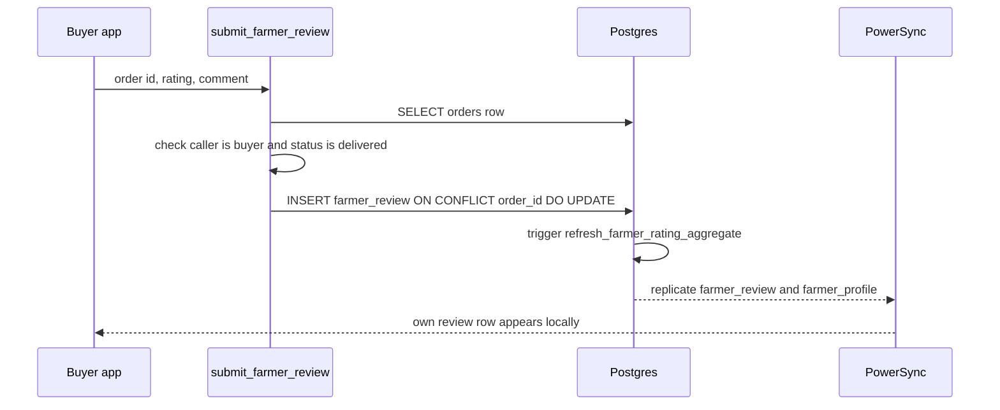

# Farmer Ratings & Reviews

**Owner:** Author C (Cart, checkout, orders, wallet, payments, reviews)
**Reviewers:** Author B (public farmer profile / marketplace), Author A (sync)
**Last verified against:** migrations up to `20260927093935_recurring_orders_rpc.sql`

## 1. Purpose

A buyer may rate (1–5) and optionally comment on the farmer of an order once that order is `delivered`. The rating is aggregated onto `farmer_profile` and shown to every buyer on the farmer's public profile. There is one review per order; the same RPC creates and edits it.

## 2. Key concepts

| Concept | Meaning |
|---|---|
| Review | One `farmer_review` row per order (`order_id` is `unique`). Buyer → farmer, rating `smallint` 1–5, optional comment. |
| Write path | Only `submit_farmer_review(...)`. No insert/update/delete RLS policy exists on `farmer_review`. |
| Aggregate | `farmer_profile.avg_rating numeric(3,2)` and `review_count integer`, maintained by trigger. |
| Reviewable | Order status must be exactly `delivered`. `completed` is NOT accepted (nothing sets `completed` anyway, see [order-state-machine.md](order-state-machine.md)). |
| Public read | Buyers read reviews via the `get_farmer_public_profile` RPC, not from the local mirror. |

## 3. Data model

### `farmer_review`

| Column | Type | Notes |
|---|---|---|
| `id` | uuid PK | `gen_random_uuid()` |
| `order_id` | uuid NOT NULL **UNIQUE** | FK `orders(id)` ON DELETE CASCADE |
| `buyer_profile_id` | uuid NOT NULL | FK `buyer_profile(profile_id)` ON DELETE CASCADE |
| `farmer_profile_id` | uuid NOT NULL | FK `farmer_profile(profile_id)` ON DELETE CASCADE |
| `rating` | smallint NOT NULL | `check (rating between 1 and 5)` |
| `comment` | text | nullable, no length limit |
| `created_at`, `updated_at` | timestamptz | `trg_farmer_review_updated_at` (`set_updated_at`) |

Indexes: `idx_farmer_review_farmer (farmer_profile_id, created_at desc)`, `idx_farmer_review_buyer (buyer_profile_id)`.

### `farmer_profile` additions

| Column | Type | Default |
|---|---|---|
| `avg_rating` | numeric(3,2) NOT NULL | 0 |
| `review_count` | integer NOT NULL | 0 |

## 4. Flow

Step by step:

1. Client decides whether to offer "Rate & review": `OrderStatus.isReviewable` (status == `delivered`) for a specific order, or `FarmerReviewService.watchLatestDeliveredOrderId(buyer, farmer)` (local `orders` query, `status = 'delivered'`, newest `placed_at`) for the farmer profile page.
2. Client checks `watchReviewForOrder(orderId)` (local) to choose "Add" vs "Edit".
3. Client calls `submit_farmer_review(p_order_id, p_rating, p_comment)`.
4. Server validates, upserts, trigger recomputes the aggregate.
5. PowerSync streams `own_farmer_reviews` and `farmer_profile` deliver the result to the buyer/farmer devices.

## 5. RPCs and triggers

| Object | Signature / event | Final definition | Side effects |
|---|---|---|---|
| `submit_farmer_review` | `(p_order_id uuid, p_rating smallint, p_comment text) returns farmer_review`, SECURITY DEFINER, `search_path = public`, granted to `authenticated` | `20260916152234_farmer_review` | Upsert on `order_id` (updates `rating`, `comment`, `updated_at`). `buyer_profile_id`/`farmer_profile_id` come from the order, never from the client. |
| `refresh_farmer_rating_aggregate` | `(p_farmer_profile_id uuid) returns void` | `20260916152234_farmer_review` | Locks the `farmer_profile` row, recomputes `round(avg(rating),2)` (0 if none) and `count(*)`. |
| `trg_farmer_review_aggregate()` | trigger function | same | Calls the refresh for `old` (DELETE) or `new`. |
| `trg_farmer_review_aggregate_iud` | AFTER INSERT OR UPDATE OF `rating` OR DELETE, per row | same | Keeps the aggregate current. Comment-only edits do not fire it. |
| `get_farmer_public_profile` | `(p_farmer_id uuid) returns jsonb`, SECURITY DEFINER, `stable`, granted to `authenticated` | `20260916155547_get_farmer_public_profile` | Read-only. Returns `null` if no `farmer_profile` row. Includes name/avatar/location text (no phone, no address), `avg_rating`, `review_count`, crops with active stock, reviews with buyer names, newest first. |

Validation inside `submit_farmer_review` (all plain `raise exception`, default SQLSTATE `P0001`): rating outside 1–5; order not found; `auth.uid() <> buyer_profile_id`; `status <> 'delivered'`.

> ⚠ Unverified: `refresh_farmer_rating_aggregate` in the migration is written `returns void as $$ perform 1 ... end; $$ language plpgsql;` with **no `BEGIN`**. That is not valid PL/pgSQL as written. Confirm the live definition (`select pg_get_functiondef('refresh_farmer_rating_aggregate(uuid)'::regprocedure)`) and correct the migration file if it was hand-fixed in the dashboard.

> ⚠ Unverified: `auth.uid() <> v_order.buyer_profile_id` evaluates to NULL (not true) when `auth.uid()` is NULL, so a service-role call would pass the ownership check. Only `authenticated` is granted, so this is not reachable from the app; confirm no Edge Function calls it.

## 6. RLS / permissions

| Table / object | Select | Insert / Update / Delete |
|---|---|---|
| `farmer_review` | `farmer_review_select_public` (`using (true)`, any role with table privilege) | none (RPC only) |
| `farmer_profile` | own row (`farmer_profile_select_own`) | own row insert/update |

Note the review table is public-read at the SQL level, while the local mirror only contains reviews where the current user is the buyer or farmer (stream `own_farmer_reviews`).

## 7. Client

| Class / member | Source | Behaviour |
|---|---|---|
| `FarmerReviewService.watchReviewsForFarmer` | local SQLite | All local reviews for a farmer. For a buyer this is only their own reviews; for the farmer it is all theirs. |
| `watchReviewForOrder`, `getReviewForOrder` | local | Own review of an order (null = not reviewed). |
| `watchLatestDeliveredOrderId` | local `orders` | Latest `delivered` order between buyer and farmer. |
| `watchRatingSummary` | local `farmer_profile` | Only the farmer's own row is synced, so a buyer gets `null`. |
| `submitReview` | RPC | Passes a Dart `int` as `p_rating`; PostgREST coerces the JSON number to `smallint`. Throws on any server error. |
| `FarmerPublicProfileService.fetchProfile` | RPC `get_farmer_public_profile` | What buyers see (rating, reviews). |
| `FarmerPublicProfileService.fetchCropListings` | RPC `get_farmer_crop_listings` | See warning below. |

> ⚠ Unverified: `get_farmer_crop_listings(p_farmer_id, p_crop_id)` is called by Dart, but no migration in the dump defines it. Confirm it exists on the live DB (owner: Author B, see [../B-marketplace/listing-lifecycle.md](../B-marketplace/listing-lifecycle.md)).

UI wording note: `OrderStatus.delivered.displayLabel` is `'Completed'`, so users see "Completed" for the only state that can be reviewed.

## 8. Offline vs online

| Action | Offline | Online |
|---|---|---|
| Read own review / eligibility | Works (local mirror) | Works |
| Submit / edit review | Fails (RPC, nothing is queued) | Works |
| View a farmer's public rating and reviews | Fails (RPC) | Works |
| Aggregate refresh on devices | Arrives on next sync | Arrives via PowerSync |

`farmer_review` is registered in `tableRegistry`, but there is no client write policy: a local write would be rejected by RLS on upload. Never write to it locally.

## 9. Edge cases and failure modes

- **Edit after delivery:** allowed indefinitely (no time window); `created_at` stays, `updated_at` moves.
- **`completed` orders:** would be rejected by the RPC (`status <> 'delivered'`) and by `isReviewable`. If a `delivered → completed` transition is ever added, change both.
- **Comment-only edit:** does not fire the aggregate trigger (`update of rating`), which is correct because the aggregate does not depend on it.
- **Comment content:** no length cap, no moderation, no trimming.
- **Order deleted:** review cascades away and the trigger recomputes.
- **Buyer with no local `orders` row yet:** `watchLatestDeliveredOrderId` returns null and the Rate button is hidden until sync completes.

## 10. How to modify safely

1. Change validation only inside `submit_farmer_review` (new migration with `create or replace`; re-issue the `revoke`/`grant`, since replacing keeps privileges but be explicit).
2. Keep the "derive buyer/farmer from the order" rule; never accept those ids from the client.
3. If you change rating scale, change the `check`, the RPC guard, the `numeric(3,2)` precision and the Dart validation together.
4. If you add a table column the farmer should see offline, add it to stream `own_farmer_reviews` and to `powersync_schema.dart` (see [../A-core/add-a-synced-table.md](../A-core/add-a-synced-table.md)).
5. To let buyers see a farmer's rating offline, you would need a new stream (only the farmer's own `farmer_profile` row syncs today). Prefer keeping the RPC.

## Source files

`lib/features/reviews/farmer_review_service.dart`, `lib/features/reviews/farmer_public_profile_service.dart`, `lib/models/farmer_review.dart`, `lib/models/farmer_public_profile.dart`, `lib/features/orders/order_detail_models.dart` (`OrderStatus.isReviewable`), `lib/core/local_db/powersync_schema.dart`, `lib/core/local_db/table_registry.dart`, sync-config (path unconfirmed) streams `own_farmer_reviews` and `farmer_profile`. Migrations: `20260916152234_farmer_review.sql`, `20260916155547_get_farmer_public_profile.sql`, `20260827094922_powersync_publication.sql` (publication baseline). Dart comments cite `20260916120000_farmer_review`; the actual filename is `20260916152234_farmer_review.sql` (see [../cross-cutting.md](../cross-cutting.md)).